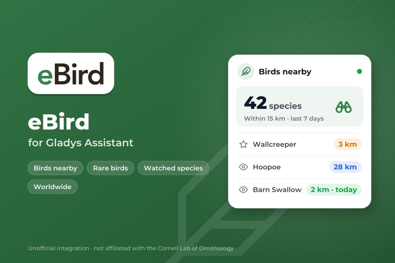
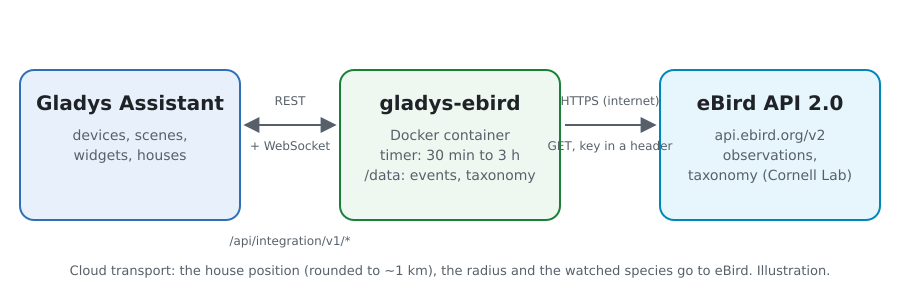
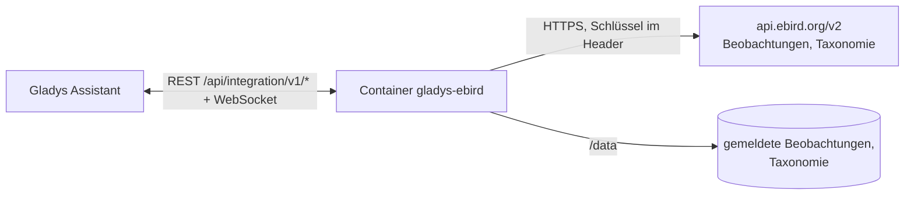
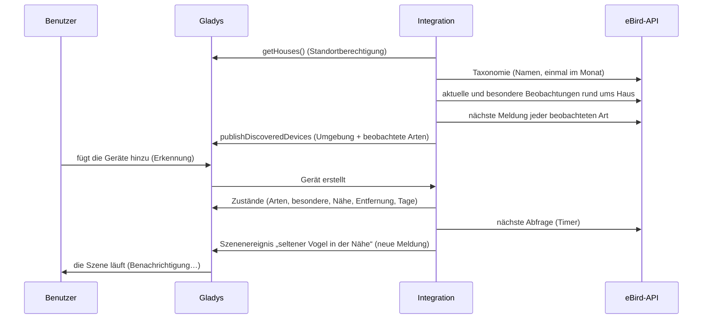
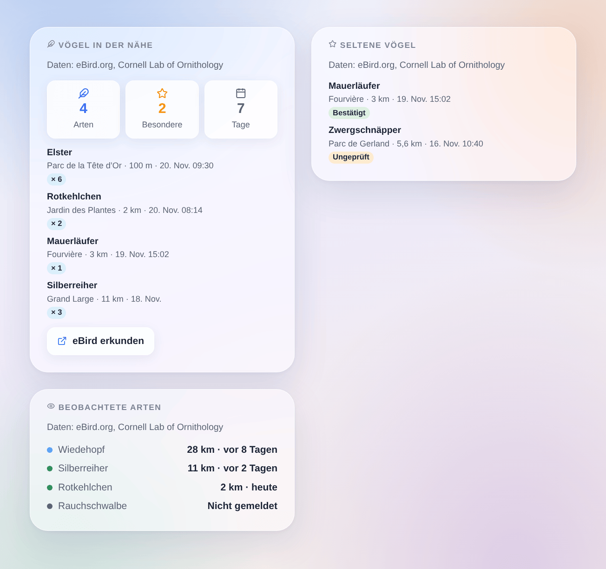

# Gladys eBird

[English](README.md) · [Français](README.fr.md) · **Deutsch** · [Español](README.es.md)

[](LICENSE)
[](https://github.com/William-De71/gladys-ebird/releases)
[](https://github.com/William-De71/gladys-ebird/actions/workflows/release.yml)
[](https://gladysassistant.com)



Externe Integration für [Gladys Assistant](https://gladysassistant.com) für **[eBird](https://ebird.org)**, das Vogelbeobachtungsnetz des Cornell Lab of Ornithology: die rund um dein Zuhause gemeldeten Vögel, die seltenen, die Arten, die du beobachtest, Szenen, wenn eine davon auftaucht, und Dashboard-Widgets. Sie liest die eBird-API 2.0 mit einem kostenlosen, persönlichen Schlüssel.

## Funktionen

- **Die Vögel rund um ein Haus** in Gladys (ein Gerät): im Umkreis in den letzten Tagen gemeldete Arten, besondere Meldungen (seltene Arten oder außerhalb der Saison), die letzte davon.
- **Ein Gerät pro beobachteter Art** (bis zu zehn, eingegeben mit deutschem, englischem, französischem oder spanischem Namen, wissenschaftlichem Namen oder eBird-Code): in der Nähe gemeldet oder nicht, nächste aktuelle Meldung in km, Tage seitdem.
- **2 Szenenauslöser**, **1 Szenenaktion** und **3 Widgets** (siehe unten); die Artnamen in der Sprache jedes Dashboards.
- Abfrage im eigenen Takt (alle 30 Min., 1 Std. oder 3 Std.): etwa 3 Anfragen plus eine pro beobachteter Art. Was die Auslöser gemeldet haben, bleibt in `/data`, ebenso die eBird-Taxonomie (monatlich neu gelesen).
- Weltweit: eBird deckt alle Länder ab.
- Vier Sprachen überall: Englisch, Französisch, Deutsch, Spanisch.

## Funktionsweise







### Transport

`transports: ["cloud"]`: Alles geht per HTTPS an `api.ebird.org`. eBird erhält den **auf 2 Dezimalstellen gerundeten Standort des Hauses (etwa 1 km)**, den Umkreis und die Codes der beobachteten Arten; der Schlüssel reist im Header, nie in der Adresse. `/data` speichert, was die Auslöser gemeldet haben, und die Taxonomie.

## Geräte und Funktionen

| Gerät             | Funktion                 | Kategorie / Typ             | Einheit |
| ----------------- | ------------------------ | --------------------------- | ------- |
| Vögel um \<Haus\> | Gemeldete Arten          | `counter-sensor` / integer  |         |
|                   | Besondere Meldungen      | `counter-sensor` / integer  |         |
|                   | Letzte besondere Meldung | `text` / text               |         |
| \<Art\> (eBird)   | In der Nähe              | `presence-sensor` / binary  |         |
|                   | Nächste Meldung          | `distance-sensor` / decimal | km      |
|                   | Tage seit der Meldung    | `duration` / integer        | Tage    |

„Arten“ zählt nur echte Arten: eBird listet auch Gruppen wie „Möwe sp.“, Paare und Hybriden. Eine Art, die nie im Umkreis von 50 km gemeldet wurde, hat keine Entfernung.

## Szenenauslöser, Aktionen und Widgets



- **Auslöser „eBird: seltener Vogel in der Nähe“**: eine besondere Meldung ist im Umkreis erschienen; einmal pro Liste und Art, höchstens 10 pro Abfrage. Variablen: `species_name`, `scientific_name`, `species_code`, `count`, `place`, `distance_km`, `observed_on`, `observed_time`, `reviewed`, `checklist_url`, `summary`, `house`.
- **Auslöser „eBird: beobachtete Art in der Nähe“**: eine beobachtete Art wird wieder im Umkreis gemeldet; Filter nach Art-Gerät. Dieselben Variablen plus `device`.
- **Aktion „eBird: Wo wurde eine Art gesehen?“**: Felder `species` (Name, wissenschaftlicher Name oder Code; Szenenvariablen erlaubt) und `days` (1 bis 30); Ausgaben `found`, `species_name`, `species_code`, `place`, `distance_km`, `observed_on`, `days_ago`, `checklist_url`, `summary`.
- **Widgets**: „Vögel in der Nähe“ (Kacheln, die neuesten Arten mit Ort, Entfernung, Datum und Anzahl), „Seltene Vögel“ (eine Karte pro Art, geprüft oder nicht, Links zur Liste und zur Artseite), „Beobachtete Arten“ (nächste Meldung und wann). Jedes nennt eBird.

Die erste Abfrage einer Suche (Haus, Umkreis, Tage, beobachtete Arten) ist eine Ausgangsbasis: Was eBird bereits listet, löst nichts aus. Beispiele:

- _Seltener Vogel in der Nähe_ → `{{triggerEvent.data.summary}}` und den Link zur Liste per Telegram senden.
- _Beobachtete Art in der Nähe_ (Rauchschwalbe) → „Die Schwalben sind zurück!“ auf dem Lautsprecher in der Küche.
- _Jeden Samstag um 8:00_ → **Wo wurde eine Art gesehen?** „Wiedehopf“ → wenn `found`, die Zusammenfassung senden.

## Voraussetzungen

- Gladys Assistant **5.3.0** oder neuer; ältere Instanzen können die Integration nicht installieren.
- Ein Haus mit Standort in Gladys (Einstellungen → Häuser).
- Ein kostenloses eBird-Konto und ein API-Schlüssel: [ebird.org/api/keygen](https://ebird.org/api/keygen). Der Schlüssel ist persönlich und nur für nicht kommerzielle Nutzung ([Nutzungsbedingungen der eBird-API](https://www.birds.cornell.edu/home/ebird-api-terms-of-use/)).

## Installation

- **Aus dem Store**: Integrationen → eBird → Installieren.
- **Über die URL des Repositorys**: Integrationen → externe Integration → `https://github.com/William-De71/gladys-ebird`.
- **Entwicklermodus**: `npm start` mit den von Gladys gelieferten Variablen starten (siehe Entwicklung).

## Konfiguration

| Feld                 | Standard                 | Bedeutung                                                                       |
| -------------------- | ------------------------ | ------------------------------------------------------------------------------- |
| eBird-API-Schlüssel  | —                        | Pflichtfeld, geheim: nie wieder angezeigt, nie protokolliert                    |
| Haus                 | erstes Haus mit Standort | Der Mittelpunkt der Suche                                                       |
| Umkreis (km)         | 10                       | 1 bis 50 km (das Maximum von eBird)                                             |
| Tage zurück          | 7                        | 1 bis 30 Tage (das Maximum von eBird)                                           |
| Beobachtete Arten    | —                        | Bis zu 10, durch Kommas getrennt: Name, wissenschaftlicher Name oder eBird-Code |
| Abfrage alle         | 1 Stunde                 | 30 Minuten, 1 Stunde oder 3 Stunden                                             |
| Sprache              | Automatisch              | Gerätenamen und Szenentexte; automatisch: die Sprache des letzten Widgets       |
| eBird jetzt abfragen | —                        | Prüft den Schlüssel, liest sofort und fasst jede beobachtete Art zusammen       |

## Verwendung

1. Fordere einen Schlüssel auf ebird.org/api/keygen an, füge ihn unter Integrationen → eBird → Konfiguration ein, gib die beobachteten Arten ein, drücke **eBird jetzt abfragen**.
2. Erkennung: füge „Vögel um …“ und die beobachteten Arten hinzu.
3. Füge die Widgets zu einem Dashboard hinzu; erstelle Szenen mit den Auslösern und der Aktion.

## Entwicklung

```bash
npm install
npm test                       # node --test, eine nachgebildete eBird-API, nie das Netz
npm run lint                   # ESLint
npm run format:check           # Prettier
npx github:GladysAssistant/integration-store . --skip-image-check
scripts/build-cover.sh         # cover.jpg aus docs/assets/cover.svg
docs/illustrations/render.sh   # docs/assets/widgets.<Sprache>.png
```

Lokal liest das SDK `GLADYS_HOST_API_URL`, `GLADYS_INTEGRATION_TOKEN` und `GLADYS_INTEGRATION_SELECTOR` (von Gladys im Entwicklermodus geliefert), und die Integration liest `TZ`. `DEBUG=gladys-integration-sdk` zeigt die Protokolle des SDK.

Die Tests decken den HTTP-Client (Schlüssel im Header, Fehler, Wiederholung), die Taxonomie (Namen, Cache, Erkennung der Eingaben), die Beobachtungen und den Schnappschuss, die Ereignisse (Ausgangsbasis, nur einmal, Neustart), die Geräte (Prüfungen von Gladys), die Widgets (`validateWidgetContent`), das Manifest, die vier Sprachen, das Release-Skript und die ganze Integration gegen das nachgebildete Gladys des SDK ab. `test/structure.test.js` friert die externen IDs und jeden gespeicherten Schlüssel ein.

## Release-Prozess


Jeder Merge auf `main` startet die CI und berechnet dann die Version aus den [Conventional Commits](https://www.conventionalcommits.org/de/) seit dem letzten Tag: `feat` → Minor, `fix` / `perf` → Patch, `!` oder `BREAKING CHANGE` → Major (ein Minor unter 1.0.0); `docs`, `chore`, `ci`, `test`, `style`, `refactor`, `build` allein veröffentlichen nichts. Der Changelog-Abschnitt wird erzeugt, der Tag gepusht, das Multi-Architektur-Image gebaut, dann erhält `main` den Release-Commit, das GitHub Release wird erstellt und ein letzter Job prüft das öffentliche Image, den Store-Validator und das Topic.

- Der Titel des Pull Requests wird zum Squash-Commit und dann zur Changelog-Zeile: auf Englisch, für den Benutzer schreiben (`pr-title.yml` prüft ihn). `CHANGELOG.md` nie von Hand bearbeiten.
- 1.0.0 ist eine Entscheidung: Actions → Release → Run workflow mit `release-as: 1.0.0`. `dry-run` zeigt Version und Notizen, ohne zu veröffentlichen.
- **Geschützter Branch**: Rulesets verlangen einen Pull Request auf `main` und sperren die `v*`-Tags; nur der Maintainer und Deploy Keys kommen durch. Das Release pusht mit dem Deploy Key der Umgebung `release` (Secret `RELEASE_DEPLOY_KEY`, nur `main`): Ein Lauf von einem anderen Branch erhält ihn nie. `build.yml` und `github-release.yml` starten nicht bei einem Tag: Das Release ruft sie auf, oder starten Sie sie von Hand (Actions → Run workflow, mit `version` für das Image), um ein Release abzuschließen.

## Fehlerbehebung

Siehe [docs/de.md](docs/de.md#fehlerbehebung). Melde Probleme mit den Versionen von Gladys und der Integration, dem Umkreis, den beobachteten Arten und der Meldung von **eBird jetzt abfragen**. Füge nie deinen API-Schlüssel ein.

## Mitwirken

Issues und Pull Requests sind willkommen. Führe `npm run format:check && npm run lint && npm test` aus, bevor du einen Pull Request öffnest, und ändere keine externe ID und keinen gespeicherten Schlüssel (siehe [CLAUDE.md](CLAUDE.md)).

## Sicherheit

Siehe [SECURITY.md](SECURITY.md): Schwachstellen vertraulich melden. Der API-Schlüssel ist ein `secret`-Feld: nie protokolliert, nie in `/data` geschrieben, nur im Header an `api.ebird.org` gesendet.

## Kommende Screenshots

Die Bilder oben sind Illustrationen, keine Screenshots. Echte Screenshots kommen nach `docs/assets/screenshots/` (PNG, 1280 × 800): `configuration.png` (die Konfiguration mit ihrem Status), `discovery.png` (die angebotene Umgebung und die beobachteten Arten), `device.png` (ein Gerät einer beobachteten Art), `scene-rare-bird.png` (eine Szene mit dem Auslöser für seltene Vögel).

## Lizenz

[Apache-Lizenz 2.0](LICENSE) — siehe auch [NOTICE](NOTICE). Beobachtungen und Taxonomie: [eBird](https://ebird.org), Cornell Lab of Ornithology, genutzt gemäß den Nutzungsbedingungen der eBird-API. Dieses Projekt ist nicht mit der Cornell University oder dem Cornell Lab of Ornithology verbunden und wird von ihnen weder unterstützt noch gesponsert. Danke an die Dokumentation und das SDK von Gladys und an die Beobachterinnen und Beobachter von eBird.
