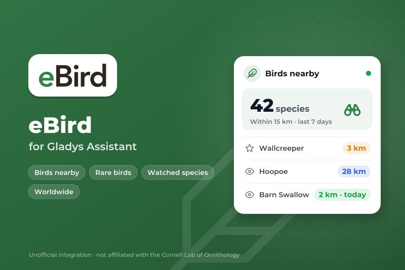
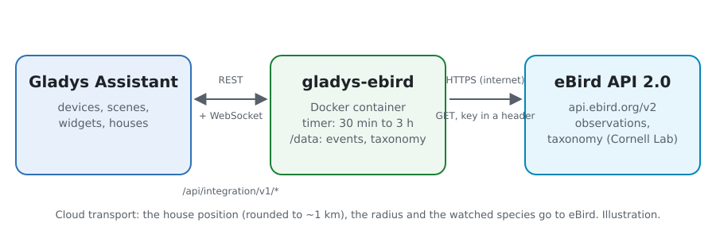
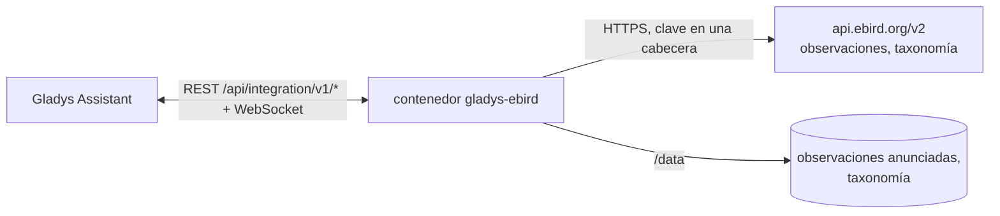
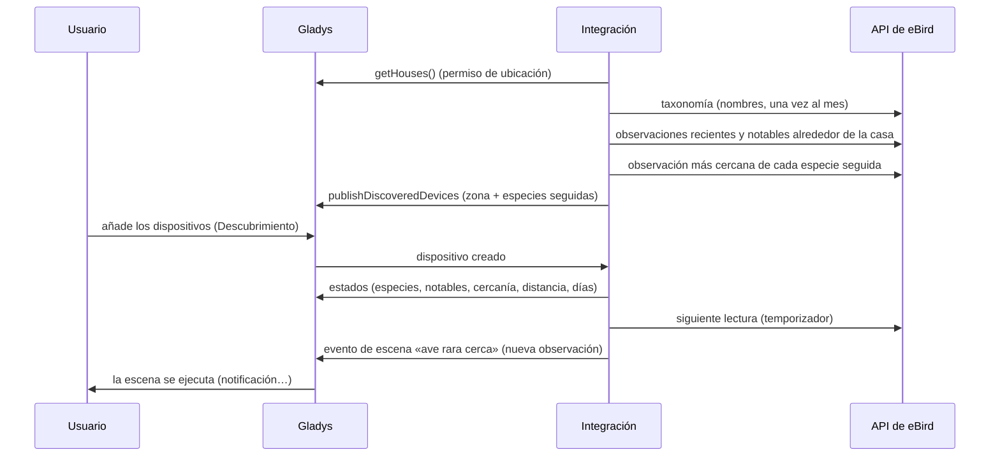
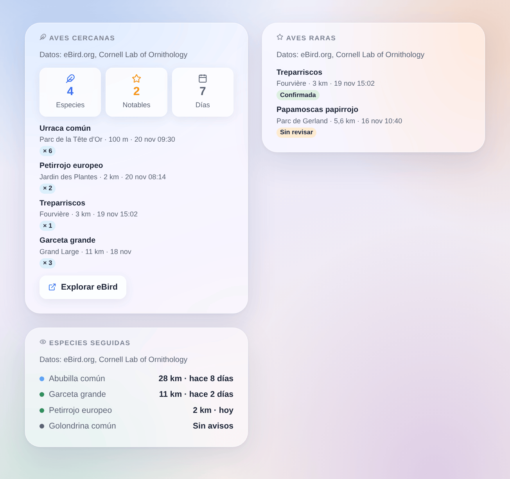

# Gladys eBird

[English](README.md) · [Français](README.fr.md) · [Deutsch](README.de.md) · **Español**

[](LICENSE)
[](https://github.com/William-De71/gladys-ebird/releases)
[](https://github.com/William-De71/gladys-ebird/actions/workflows/release.yml)
[](https://gladysassistant.com)



Integración externa de [Gladys Assistant](https://gladysassistant.com) para **[eBird](https://ebird.org)**, la red de observación de aves del Cornell Lab of Ornithology: las aves observadas cerca de su casa, las raras, las especies que sigue, escenas cuando aparece una de ellas y widgets de panel. Lee la API 2.0 de eBird con una clave gratuita y personal.

## Funciones

- **Las aves alrededor de una casa** de Gladys (un dispositivo): especies observadas en un radio en los últimos días, observaciones notables (especies raras o fuera de temporada), la última de ellas.
- **Un dispositivo por especie seguida** (hasta diez, escritas con su nombre en español, inglés, francés o alemán, su nombre científico o su código de eBird): observada cerca o no, observación reciente más cercana en km, días desde entonces.
- **2 disparadores de escena**, **1 acción de escena** y **3 widgets** (abajo); los nombres de las especies en el idioma de cada panel.
- Lectura a su propio ritmo (cada 30 min, 1 h o 3 h): unas 3 solicitudes, más una por especie seguida. Lo que anunciaron los disparadores se guarda en `/data`, igual que la taxonomía de eBird (releída cada mes).
- En todo el mundo: eBird cubre todos los países.
- Cuatro idiomas en todo: inglés, francés, alemán, español.

## Funcionamiento







### Transporte

`transports: ["cloud"]`: todo va a `api.ebird.org` por HTTPS. eBird recibe la **posición de la casa redondeada a 2 decimales (aprox. 1 km)**, el radio y los códigos de las especies seguidas; la clave viaja en una cabecera, nunca en la dirección. `/data` guarda lo que anunciaron los disparadores y la taxonomía.

## Dispositivos y funciones

| Dispositivo                | Función                    | Categoría / tipo            | Unidad |
| -------------------------- | -------------------------- | --------------------------- | ------ |
| Aves alrededor de \<casa\> | Especies observadas        | `counter-sensor` / integer  |        |
|                            | Observaciones notables     | `counter-sensor` / integer  |        |
|                            | Última observación notable | `text` / text               |        |
| \<especie\> (eBird)        | Cerca                      | `presence-sensor` / binary  |        |
|                            | Observación más cercana    | `distance-sensor` / decimal | km     |
|                            | Días desde la observación  | `duration` / integer        | días   |

«Especies» solo cuenta las especies verdaderas: eBird también lista grupos como «gaviota sp.», pares e híbridos. Una especie nunca observada a menos de 50 km no tiene distancia.

## Disparadores, acciones de escena y widgets



- **Disparador «eBird: ave rara cerca»**: apareció una observación notable en el radio; una vez por lista y especie, 10 como máximo por lectura. Variables: `species_name`, `scientific_name`, `species_code`, `count`, `place`, `distance_km`, `observed_on`, `observed_time`, `reviewed`, `checklist_url`, `summary`, `house`.
- **Disparador «eBird: especie seguida cerca»**: una especie seguida vuelve a observarse en el radio; filtro por dispositivo de especie. Mismas variables, más `device`.
- **Acción «eBird: ¿dónde se vio una especie?»**: campos `species` (nombre, nombre científico o código; se admiten variables de escena) y `days` (1 a 30); salidas `found`, `species_name`, `species_code`, `place`, `distance_km`, `observed_on`, `days_ago`, `checklist_url`, `summary`.
- **Widgets**: «Aves cercanas» (mosaicos, las especies más recientes con lugar, distancia, fecha y número), «Aves raras» (una tarjeta por especie, revisada o no, enlaces a la lista y a la página de la especie), «Especies seguidas» (observación más cercana y cuándo). Cada uno cita a eBird.

La primera lectura de una búsqueda (casa, radio, días, especies seguidas) sirve de referencia: lo que eBird ya lista no dispara nada. Ejemplos:

- _Ave rara cerca_ → enviar `{{triggerEvent.data.summary}}` y el enlace de la lista por Telegram.
- _Especie seguida cerca_ (Golondrina común) → «¡Han vuelto las golondrinas!» en el altavoz de la cocina.
- _Cada sábado a las 8:00_ → **¿dónde se vio una especie?** «Abubilla» → si `found`, enviar el resumen.

## Requisitos

- Gladys Assistant **5.3.0** o posterior; las instancias más antiguas no pueden instalar la integración.
- Una casa con ubicación en Gladys (Ajustes → Casas).
- Una cuenta gratuita de eBird y una clave de API: [ebird.org/api/keygen](https://ebird.org/api/keygen). La clave es personal y para uso no comercial ([condiciones de uso de la API de eBird](https://www.birds.cornell.edu/home/ebird-api-terms-of-use/)).

## Instalación

- **Desde la tienda**: Integraciones → eBird → Instalar.
- **Desde la URL del repositorio**: Integraciones → integración externa → `https://github.com/William-De71/gladys-ebird`.
- **Modo desarrollador**: ejecute `npm start` con las variables que da Gladys (ver Desarrollo).

## Configuración

| Campo                 | Por defecto                | Significado                                                                           |
| --------------------- | -------------------------- | ------------------------------------------------------------------------------------- |
| Clave de API de eBird | —                          | Obligatoria, secreta: nunca se vuelve a mostrar ni se registra                        |
| Casa                  | primera casa con ubicación | El centro de la búsqueda                                                              |
| Radio (km)            | 10                         | 1 a 50 km (el máximo de eBird)                                                        |
| Días atrás            | 7                          | 1 a 30 días (el máximo de eBird)                                                      |
| Especies seguidas     | —                          | Hasta 10, separadas por comas: nombre, nombre científico o código de eBird            |
| Lectura cada          | 1 hora                     | 30 minutos, 1 hora o 3 horas                                                          |
| Idioma                | Automático                 | Nombres de los dispositivos y textos de las escenas; automático: el del último widget |
| Leer eBird ahora      | —                          | Comprueba la clave, lee ahora y resume cada especie seguida                           |

## Uso

1. Solicite una clave en ebird.org/api/keygen, péguela en Integraciones → eBird → Configuración, escriba las especies seguidas, pulse **Leer eBird ahora**.
2. Descubrimiento: añada «Aves alrededor de …» y las especies seguidas.
3. Añada los widgets a un panel; cree escenas con los disparadores y la acción.

## Desarrollo

```bash
npm install
npm test                       # node --test, una API de eBird simulada, nunca la red
npm run lint                   # ESLint
npm run format:check           # Prettier
npx github:GladysAssistant/integration-store . --skip-image-check
scripts/build-cover.sh         # cover.jpg a partir de docs/assets/cover.svg
docs/illustrations/render.sh   # docs/assets/widgets.<idioma>.png
```

En local, el SDK lee `GLADYS_HOST_API_URL`, `GLADYS_INTEGRATION_TOKEN` y `GLADYS_INTEGRATION_SELECTOR` (que Gladys da en modo desarrollador), y la integración lee `TZ`. `DEBUG=gladys-integration-sdk` muestra los registros del SDK.

Las pruebas cubren el cliente HTTP (clave en cabecera, errores, reintento), la taxonomía (nombres, caché, reconocimiento de lo que escribe el usuario), las observaciones y la instantánea, los eventos (referencia, una sola vez, reinicio), los dispositivos (comprobaciones de Gladys), los widgets (`validateWidgetContent`), el manifiesto, los cuatro idiomas, el script de publicación y toda la integración contra el Gladys simulado del SDK. `test/structure.test.js` congela los identificadores externos y cada clave que guardan los usuarios.

## Proceso de publicación


Cada fusión en `main` ejecuta la CI y luego calcula la versión a partir de los [Conventional Commits](https://www.conventionalcommits.org/es/) desde la última etiqueta: `feat` → menor, `fix` / `perf` → parche, `!` o `BREAKING CHANGE` → mayor (una menor por debajo de 1.0.0); `docs`, `chore`, `ci`, `test`, `style`, `refactor`, `build` solos no publican nada. Se genera la sección del changelog, se sube la etiqueta, se construye la imagen multiarquitectura, luego `main` recibe el commit de publicación, se crea la GitHub Release y un último job comprueba la imagen pública, el validador de la tienda y el topic.

- El título de la pull request se convierte en el commit squash y luego en la línea del changelog: escríbalo en inglés, para el usuario (`pr-title.yml` lo comprueba). No edite nunca `CHANGELOG.md` a mano.
- La 1.0.0 es una decisión: Actions → Release → Run workflow con `release-as: 1.0.0`. `dry-run` muestra la versión y las notas sin publicar.
- **Rama protegida**: unos rulesets exigen una pull request en `main` y bloquean las etiquetas `v*`; solo pasan el mantenedor y las deploy keys. La publicación hace push con la deploy key del entorno `release` (secreto `RELEASE_DEPLOY_KEY`, solo `main`): una ejecución lanzada desde otra rama nunca la obtiene. `build.yml` y `github-release.yml` no arrancan con una etiqueta: la publicación los llama, o lánzelos a mano (Actions → Run workflow, con `version` para la imagen) para terminar una publicación.

## Solución de problemas

Ver [docs/es.md](docs/es.md#solución-de-problemas). Informe de los problemas con las versiones de Gladys y de la integración, el radio, las especies seguidas y el mensaje de **Leer eBird ahora**. No pegue nunca su clave de API.

## Contribuir

Las issues y pull requests son bienvenidas. Ejecute `npm run format:check && npm run lint && npm test` antes de abrir una pull request y no cambie ningún identificador externo ni ninguna clave guardada (ver [CLAUDE.md](CLAUDE.md)).

## Seguridad

Ver [SECURITY.md](SECURITY.md): informe de las vulnerabilidades en privado. La clave de API es un campo `secret`: nunca se registra, nunca se escribe en `/data`, solo se envía a `api.ebird.org` en una cabecera.

## Capturas pendientes

Las imágenes de arriba son ilustraciones, no capturas de pantalla. Las capturas reales irán en `docs/assets/screenshots/` (PNG, 1280 × 800): `configuration.png` (la configuración con su estado), `discovery.png` (la zona y las especies seguidas propuestas), `device.png` (un dispositivo de especie seguida), `scene-rare-bird.png` (una escena con el disparador de ave rara).

## Licencia

[Licencia Apache 2.0](LICENSE) — ver también [NOTICE](NOTICE). Observaciones y taxonomía: [eBird](https://ebird.org), Cornell Lab of Ornithology, usadas según las condiciones de uso de la API de eBird. Este proyecto no está afiliado a la Universidad Cornell ni al Cornell Lab of Ornithology, ni respaldado o patrocinado por ellos. Gracias a la documentación y al SDK de Gladys, y a los observadores de eBird.
