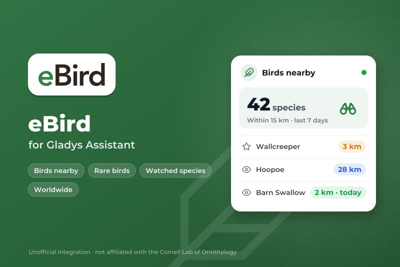
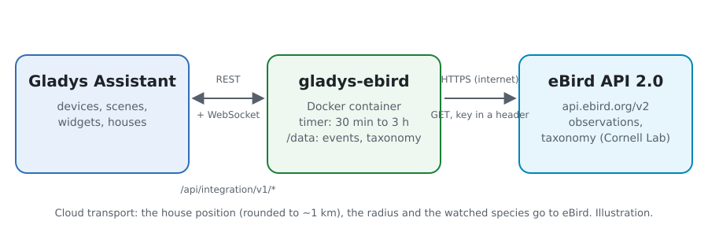
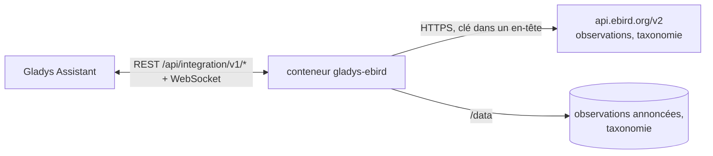
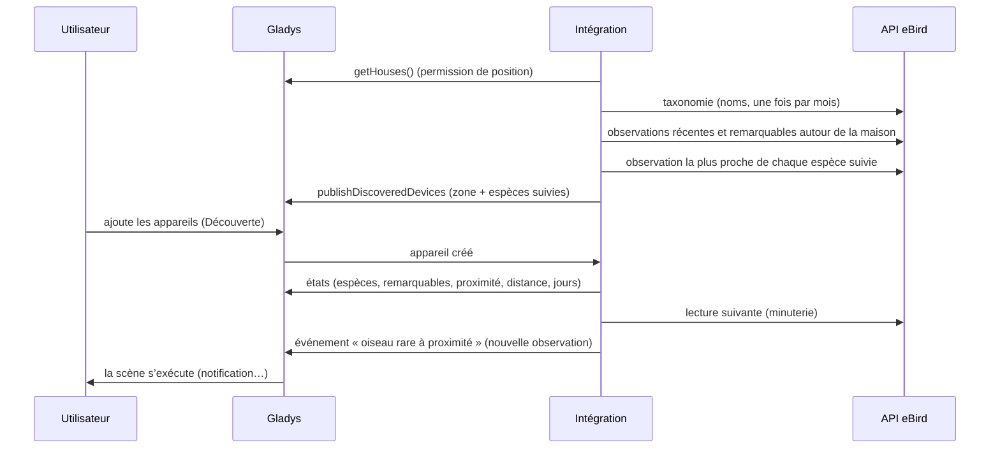
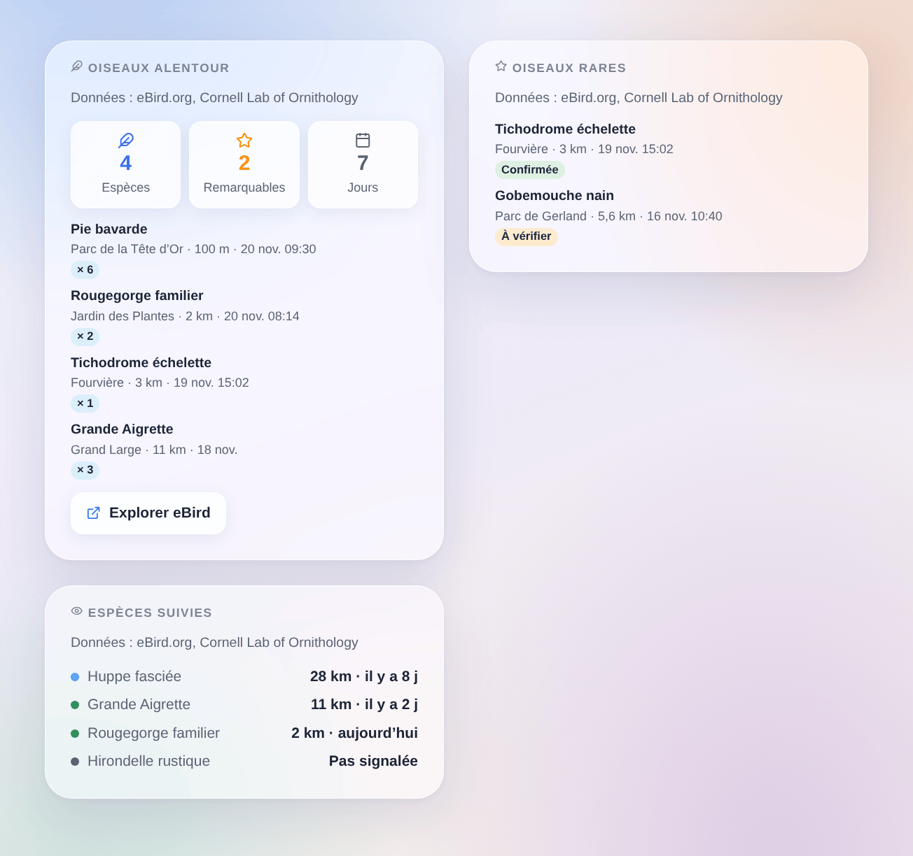

# Gladys eBird

[English](README.md) · **Français** · [Deutsch](README.de.md) · [Español](README.es.md)

[](LICENSE)
[](https://github.com/William-De71/gladys-ebird/releases)
[](https://github.com/William-De71/gladys-ebird/actions/workflows/release.yml)
[](https://gladysassistant.com)



Intégration externe de [Gladys Assistant](https://gladysassistant.com) pour **[eBird](https://ebird.org)**, le réseau d’observation des oiseaux du Cornell Lab of Ornithology : les oiseaux signalés autour de chez vous, les espèces rares, celles que vous suivez, des scènes quand l’une d’elles apparaît, et des widgets de tableau de bord. Elle lit l’API eBird 2.0 avec une clé gratuite et personnelle.

## Fonctionnalités

- **Les oiseaux autour d’une maison** de Gladys (un appareil) : espèces signalées dans un rayon ces derniers jours, observations remarquables (espèces rares ou hors saison), la dernière d’entre elles.
- **Un appareil par espèce suivie** (dix au plus, tapées par leur nom en français, anglais, allemand ou espagnol, leur nom scientifique ou leur code eBird) : signalée à proximité ou non, observation récente la plus proche en km, jours depuis.
- **2 déclencheurs de scène**, **1 action de scène** et **3 widgets** (ci-dessous) ; les noms des espèces dans la langue de chaque tableau de bord.
- Lecture à son propre rythme (toutes les 30 min, 1 h ou 3 h) : environ 3 requêtes, plus une par espèce suivie. Ce que les déclencheurs ont annoncé est gardé dans `/data`, comme la taxonomie eBird (relue chaque mois).
- Partout dans le monde : eBird couvre tous les pays.
- Quatre langues partout : anglais, français, allemand, espagnol.

## Fonctionnement







### Transport

`transports: ["cloud"]` : tout part vers `api.ebird.org` en HTTPS. eBird reçoit la **position de la maison arrondie à 2 décimales (environ 1 km)**, le rayon et les codes des espèces suivies ; la clé voyage dans un en-tête, jamais dans l’adresse. `/data` garde ce que les déclencheurs ont annoncé et la taxonomie.

## Appareils et fonctionnalités

| Appareil                     | Fonctionnalité                   | Catégorie / type            | Unité |
| ---------------------------- | -------------------------------- | --------------------------- | ----- |
| Oiseaux autour de \<maison\> | Espèces signalées                | `counter-sensor` / integer  |       |
|                              | Observations remarquables        | `counter-sensor` / integer  |       |
|                              | Dernière observation remarquable | `text` / text               |       |
| \<espèce\> (eBird)           | À proximité                      | `presence-sensor` / binary  |       |
|                              | Observation la plus proche       | `distance-sensor` / decimal | km    |
|                              | Jours depuis l’observation       | `duration` / integer        | jours |

« Espèces » ne compte que les vraies espèces : eBird liste aussi des groupes comme « goéland sp. », des paires et des hybrides. Une espèce jamais signalée à moins de 50 km n’a pas de distance.

## Déclencheurs, actions de scène et widgets



- **Déclencheur « eBird : oiseau rare à proximité »** : une observation remarquable est apparue dans le rayon ; une fois par liste et par espèce, 10 au plus par lecture. Variables : `species_name`, `scientific_name`, `species_code`, `count`, `place`, `distance_km`, `observed_on`, `observed_time`, `reviewed`, `checklist_url`, `summary`, `house`.
- **Déclencheur « eBird : espèce suivie à proximité »** : une espèce suivie est de nouveau signalée dans le rayon ; filtre par appareil d’espèce. Mêmes variables, plus `device`.
- **Action « eBird : où a-t-on vu une espèce ? »** : champs `species` (nom, nom scientifique ou code ; variables de scène acceptées) et `days` (1 à 30) ; sorties `found`, `species_name`, `species_code`, `place`, `distance_km`, `observed_on`, `days_ago`, `checklist_url`, `summary`.
- **Widgets** : « Oiseaux alentour » (tuiles, espèces les plus récentes avec lieu, distance, date et nombre), « Oiseaux rares » (une carte par espèce, vérifiée ou non, liens vers la liste et la page de l’espèce), « Espèces suivies » (observation la plus proche et sa date). Chacun cite eBird.

La première lecture d’une recherche (maison, rayon, jours, espèces suivies) sert de référence : ce qu’eBird liste déjà ne déclenche rien. Exemples :

- _Oiseau rare à proximité_ → envoyer `{{triggerEvent.data.summary}}` et le lien de la liste par Telegram.
- _Espèce suivie à proximité_ (Hirondelle rustique) → « Les hirondelles sont de retour ! » sur l’enceinte de la cuisine.
- _Chaque samedi à 8 h_ → **où a-t-on vu une espèce ?** « Huppe fasciée » → si `found`, envoyer le résumé.

## Prérequis

- Gladys Assistant **5.3.0** ou plus récent ; les instances plus anciennes ne peuvent pas installer l’intégration.
- Une maison avec une position dans Gladys (Paramètres → Maisons).
- Un compte eBird gratuit et une clé d’API : [ebird.org/api/keygen](https://ebird.org/api/keygen). La clé est personnelle et réservée à un usage non commercial ([conditions d’utilisation de l’API eBird](https://www.birds.cornell.edu/home/ebird-api-terms-of-use/)).

## Installation

- **Depuis le store** : Intégrations → eBird → Installer.
- **Depuis l’URL du dépôt** : Intégrations → intégration externe → `https://github.com/William-De71/gladys-ebird`.
- **Mode développeur** : lancez `npm start` avec les variables fournies par Gladys (voir Développement).

## Configuration

| Champ                 | Défaut                             | Rôle                                                                                |
| --------------------- | ---------------------------------- | ----------------------------------------------------------------------------------- |
| Clé d’API eBird       | —                                  | Obligatoire, secrète : plus jamais affichée, jamais journalisée                     |
| Maison                | première maison qui a une position | Le centre de la recherche                                                           |
| Rayon (km)            | 10                                 | 1 à 50 km (le maximum d’eBird)                                                      |
| Jours en arrière      | 7                                  | 1 à 30 jours (le maximum d’eBird)                                                   |
| Espèces suivies       | —                                  | 10 au plus, séparées par des virgules : nom, nom scientifique ou code eBird         |
| Lecture toutes les    | 1 heure                            | 30 minutes, 1 heure ou 3 heures                                                     |
| Langue                | Automatique                        | Noms des appareils et textes des scènes ; automatique : la langue du dernier widget |
| Lire eBird maintenant | —                                  | Vérifie la clé, lit tout de suite et résume chaque espèce suivie                    |

## Utilisation

1. Demandez une clé sur ebird.org/api/keygen, collez-la dans Intégrations → eBird → Configuration, tapez les espèces suivies, appuyez sur **Lire eBird maintenant**.
2. Découverte : ajoutez « Oiseaux autour de … » et les espèces suivies.
3. Ajoutez les widgets à un tableau de bord ; créez des scènes avec les déclencheurs et l’action.

## Développement

```bash
npm install
npm test                       # node --test, une fausse API eBird, jamais le réseau
npm run lint                   # ESLint
npm run format:check           # Prettier
npx github:GladysAssistant/integration-store . --skip-image-check
scripts/build-cover.sh         # cover.jpg depuis docs/assets/cover.svg
docs/illustrations/render.sh   # docs/assets/widgets.<langue>.png
```

En local, le SDK lit `GLADYS_HOST_API_URL`, `GLADYS_INTEGRATION_TOKEN` et `GLADYS_INTEGRATION_SELECTOR` (fournies par Gladys en mode développeur), et l’intégration lit `TZ`. `DEBUG=gladys-integration-sdk` affiche les journaux du SDK.

Les tests couvrent le client HTTP (clé en en-tête, erreurs, nouvel essai), la taxonomie (noms, cache, reconnaissance de ce que l’utilisateur tape), les observations et l’instantané, les événements (référence, une seule fois, redémarrage), les appareils (contrôles de Gladys), les widgets (`validateWidgetContent`), le manifeste, les quatre langues, le script de release et toute l’intégration contre le faux Gladys du SDK. `test/structure.test.js` fige les identifiants externes et chaque clé enregistrée par les utilisateurs.

## Processus de release


Chaque fusion sur `main` lance la CI, puis calcule la version à partir des [Conventional Commits](https://www.conventionalcommits.org/fr/) depuis le dernier tag : `feat` → mineure, `fix` / `perf` → correctif, `!` ou `BREAKING CHANGE` → majeure (une mineure sous 1.0.0) ; `docs`, `chore`, `ci`, `test`, `style`, `refactor`, `build` seuls ne publient rien. La section du changelog est générée, le tag poussé, l’image multi-architecture construite, puis `main` reçoit le commit de release, la GitHub Release est créée et un dernier job vérifie l’image publique, le validateur du store et le topic.

- Le titre de la pull request devient le commit squash, puis la ligne du changelog : écrivez-le en anglais, pour l’utilisateur (`pr-title.yml` le vérifie). N’éditez jamais `CHANGELOG.md` à la main.
- La 1.0.0 est une décision : Actions → Release → Run workflow avec `release-as: 1.0.0`. `dry-run` affiche la version et les notes sans rien publier.
- **Branche protégée** : la release pousse son commit sur `main` avec `GITHUB_TOKEN`. Le ruleset `protect-main` (ni suppression, ni force-push) le laisse passer ; une règle plus stricte (pull request obligatoire, status checks) demanderait GitHub Actions dans sa liste de contournement, ou une GitHub App.

## Dépannage

Voir [docs/fr.md](docs/fr.md#dépannage). Signalez un problème avec les versions de Gladys et de l’intégration, le rayon, les espèces suivies et le message de **Lire eBird maintenant**. Ne collez jamais votre clé d’API.

## Contribuer

Les issues et pull requests sont bienvenues. Lancez `npm run format:check && npm run lint && npm test` avant d’ouvrir une pull request, et ne changez aucun identifiant externe ni aucune clé enregistrée (voir [CLAUDE.md](CLAUDE.md)).

## Sécurité

Voir [SECURITY.md](SECURITY.md) : signalez les vulnérabilités en privé. La clé d’API est un champ `secret` : jamais journalisée, jamais écrite dans `/data`, envoyée seulement à `api.ebird.org` dans un en-tête.

## Captures à venir

Les images ci-dessus sont des illustrations, pas des captures d’écran. Les vraies captures iront dans `docs/assets/screenshots/` (PNG, 1280 × 800) : `configuration.png` (la configuration et son statut), `discovery.png` (la zone et les espèces suivies proposées), `device.png` (un appareil d’espèce suivie), `scene-rare-bird.png` (une scène sur le déclencheur d’oiseau rare).

## Licence

[Licence Apache 2.0](LICENSE) — voir aussi [NOTICE](NOTICE). Observations et taxonomie : [eBird](https://ebird.org), Cornell Lab of Ornithology, utilisées selon les conditions d’utilisation de l’API eBird. Ce projet n’est ni affilié à l’université Cornell ni au Cornell Lab of Ornithology, ni approuvé ou sponsorisé par eux. Merci à la documentation et au SDK de Gladys, et aux observateurs d’eBird.
