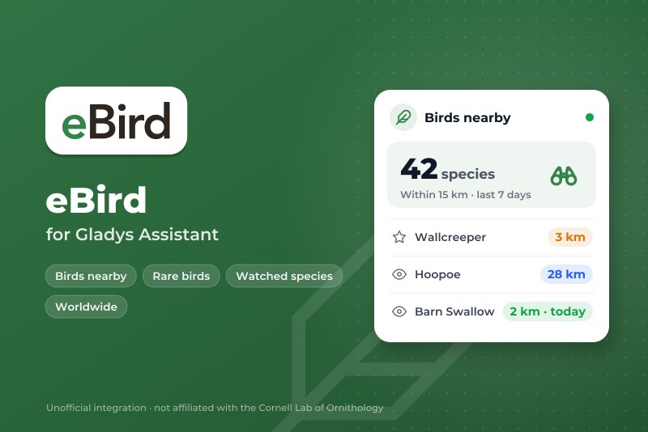
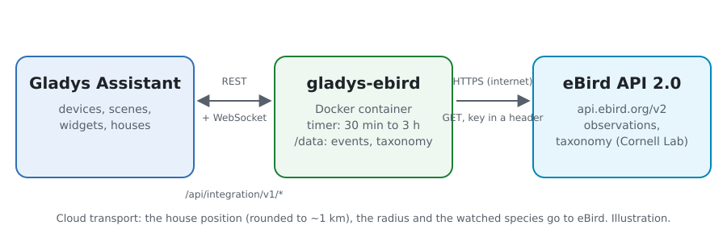
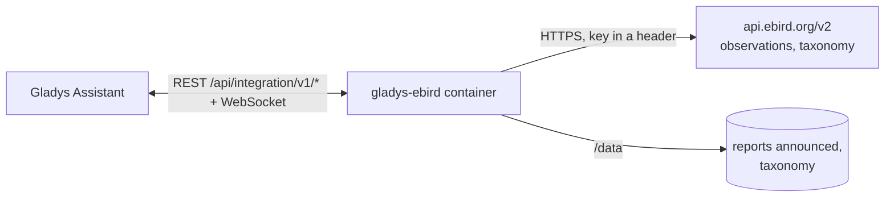
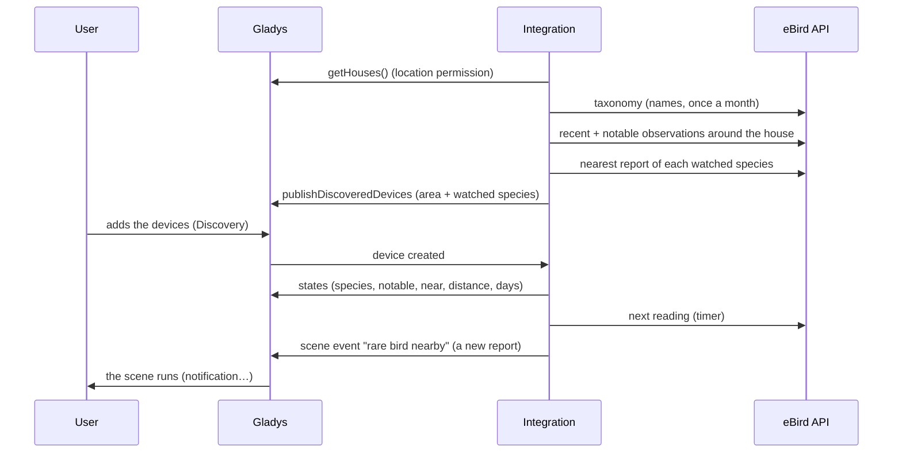
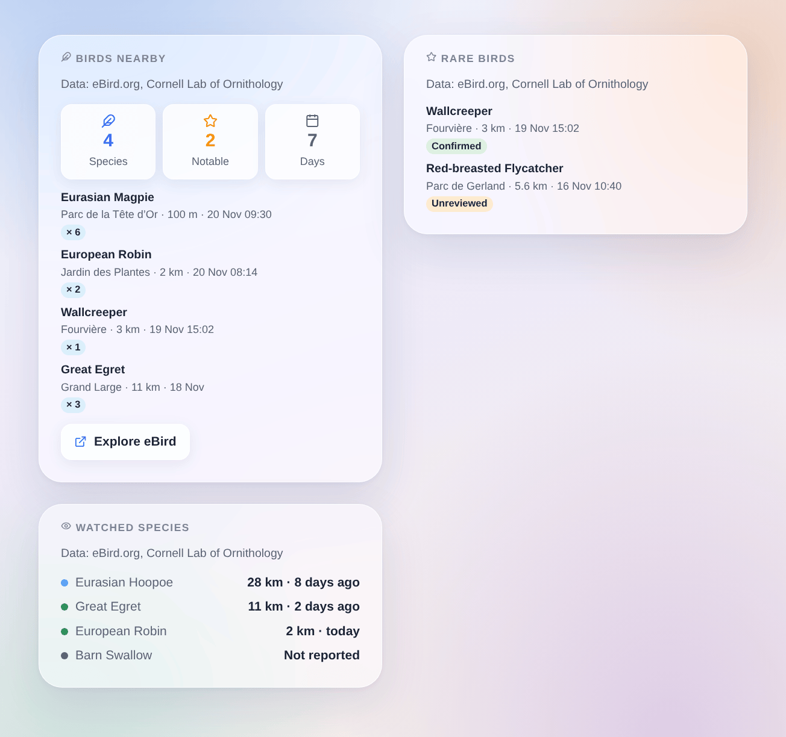

# Gladys eBird

**English** · [Français](README.fr.md) · [Deutsch](README.de.md) · [Español](README.es.md)

[](LICENSE)
[](https://github.com/William-De71/gladys-ebird/releases)
[](https://github.com/William-De71/gladys-ebird/actions/workflows/release.yml)
[](https://gladysassistant.com)



[Gladys Assistant](https://gladysassistant.com) external integration for **[eBird](https://ebird.org)**, the bird observation network of the Cornell Lab of Ornithology: the birds reported around your home, the rare ones, the species you watch, scenes when one shows up, and dashboard widgets. It reads the eBird API 2.0 with a free, personal key.

## Features

- **The birds around a house** of Gladys (a device): species reported within a radius over the last days, notable reports (rare species or out of season), the last notable one.
- **One device per watched species** (up to ten, typed by name in English, French, German or Spanish, scientific name or eBird code): reported nearby or not, nearest recent report in km, days since.
- **2 scene triggers**, **1 scene action** and **3 dashboard widgets** (below); the species names in the language of each dashboard.
- Read on its own timer (every 30 min, 1 h or 3 h): about 3 requests, plus one per watched species. What the triggers announced is kept in `/data`, as is the eBird taxonomy (read again monthly).
- Worldwide: eBird covers every country.
- Four languages everywhere: English, French, German, Spanish.

## How it works







### Transport

`transports: ["cloud"]`: everything goes to `api.ebird.org` over HTTPS. eBird receives the **position of the house rounded to 2 decimals (about 1 km)**, the radius and the codes of the species you watch; the key travels in a header, never in the URL. `/data` keeps what the triggers announced and the taxonomy.

## Devices and features

| Device                 | Feature             | Category / type             | Unit |
| ---------------------- | ------------------- | --------------------------- | ---- |
| Birds around \<house\> | Species reported    | `counter-sensor` / integer  |      |
|                        | Notable reports     | `counter-sensor` / integer  |      |
|                        | Last notable report | `text` / text               |      |
| \<species\> (eBird)    | Nearby              | `presence-sensor` / binary  |      |
|                        | Nearest report      | `distance-sensor` / decimal | km   |
|                        | Days since seen     | `duration` / integer        | days |

"Species" counts the true species only: eBird also lists groups such as "gull sp.", pairs and hybrids. A species never reported within 50 km keeps no distance.

## Scene triggers, actions and widgets



- **Trigger "eBird: rare bird nearby"**: a notable report appeared within the radius; once per checklist and species, at most 10 per reading. Variables: `species_name`, `scientific_name`, `species_code`, `count`, `place`, `distance_km`, `observed_on`, `observed_time`, `reviewed`, `checklist_url`, `summary`, `house`.
- **Trigger "eBird: watched species nearby"**: a watched species is reported within the radius again; filter by species device. Same variables, plus `device`.
- **Action "eBird: where was a species seen?"**: fields `species` (name, scientific name or code; scene variables allowed) and `days` (1 to 30); outputs `found`, `species_name`, `species_code`, `place`, `distance_km`, `observed_on`, `days_ago`, `checklist_url`, `summary`.
- **Widgets**: "Birds nearby" (tiles, the most recent species with place, distance, date and count), "Rare birds" (one card per species, reviewed or not, links to the checklist and the species page), "Watched species" (nearest report and when). Each credits eBird.

The first reading of a search (house, radius, days, watched species) is a baseline: what eBird already lists fires nothing. Examples:

- _Rare bird nearby_ → send `{{triggerEvent.data.summary}}` and the checklist link by Telegram.
- _Watched species nearby_ (Barn Swallow) → "The swallows are back!" on the speaker of the kitchen.
- _Every Saturday at 8:00_ → **where was a species seen?** "Hoopoe" → if `found`, send the summary.

## Requirements

- Gladys Assistant **5.3.0** or later; older instances cannot install the integration.
- A house with a position in Gladys (Settings → Houses).
- A free eBird account and an API key: [ebird.org/api/keygen](https://ebird.org/api/keygen). The key is personal and for non-commercial use ([eBird API Terms of Use](https://www.birds.cornell.edu/home/ebird-api-terms-of-use/)).

## Installation

- **From the store**: Integrations → eBird → Install.
- **From the repository URL**: Integrations → external integration → `https://github.com/William-De71/gladys-ebird`.
- **Developer mode**: run `npm start` with the variables given by Gladys (see Development).

## Configuration

| Field           | Default                     | Meaning                                                                  |
| --------------- | --------------------------- | ------------------------------------------------------------------------ |
| eBird API key   | —                           | Required, a secret: never shown again, never logged                      |
| House           | first house with a position | The center of the search                                                 |
| Radius (km)     | 10                          | 1 to 50 km (the eBird maximum)                                           |
| Days back       | 7                           | 1 to 30 days (the eBird maximum)                                         |
| Watched species | —                           | Up to 10, separated by commas: name, scientific name or eBird code       |
| Reading every   | 1 hour                      | 30 minutes, 1 hour or 3 hours                                            |
| Language        | Automatic                   | Device names and scene texts; automatic: the language of the last widget |
| Read eBird now  | —                           | Checks the key, reads now and sums up each watched species               |

## Usage

1. Request a key on ebird.org/api/keygen, paste it in Integrations → eBird → Configuration, type the species you watch, press **Read eBird now**.
2. Discovery: add "Birds around …" and the watched species.
3. Add the widgets to a dashboard; create scenes with the triggers and the action.

## Development

```bash
npm install
npm test                       # node --test, a fake eBird API, never the network
npm run lint                   # ESLint
npm run format:check           # Prettier
npx github:GladysAssistant/integration-store . --skip-image-check
scripts/build-cover.sh         # cover.jpg from docs/assets/cover.svg
docs/illustrations/render.sh   # docs/assets/widgets.<lang>.png
```

Locally, the SDK reads `GLADYS_HOST_API_URL`, `GLADYS_INTEGRATION_TOKEN` and `GLADYS_INTEGRATION_SELECTOR` (given by Gladys in developer mode), and the integration reads `TZ`. `DEBUG=gladys-integration-sdk` shows the SDK logs.

The tests cover the HTTP client (header key, errors, retry), the taxonomy (names, cache, resolution of what the user types), the observations and the snapshot, the events (baseline, once only, restart), the devices (Gladys checks), the widgets (`validateWidgetContent`), the manifest, the four languages, the release script and the whole integration against the fake Gladys of the SDK. `test/structure.test.js` freezes the external ids and every key users store.

## Release process


Every merge on `main` runs the CI, then computes the version from the [Conventional Commits](https://www.conventionalcommits.org/) since the last tag: `feat` → minor, `fix` / `perf` → patch, `!` or `BREAKING CHANGE` → major (a minor below 1.0.0); `docs`, `chore`, `ci`, `test`, `style`, `refactor`, `build` alone publish nothing. The changelog section is generated, the tag pushed, the multi-architecture image built, then `main` receives the release commit, the GitHub Release is created and a last job checks the public image, the store validator and the topic.

- The pull request title becomes the squash commit, then the changelog line: write it in English, for the user (`pr-title.yml` checks it). Never edit `CHANGELOG.md` by hand.
- 1.0.0 is a decision: Actions → Release → Run workflow with `release-as: 1.0.0`. `dry-run` shows the version and the notes without publishing.
- **Protected branch**: the release pushes its commit to `main` with `GITHUB_TOKEN`. The `protect-main` ruleset (no deletion, no force-push) lets it through; a stricter rule (pull request required, status checks) would need GitHub Actions in its bypass list, or a GitHub App.

## Troubleshooting

See [docs/en.md](docs/en.md#troubleshooting). Report issues with the versions of Gladys and of the integration, the radius, the watched species and the message of **Read eBird now**. Never paste your API key.

## Contributing

Issues and pull requests are welcome. Run `npm run format:check && npm run lint && npm test` before opening a pull request, and keep every external id and stored key unchanged (see [CLAUDE.md](CLAUDE.md)).

## Security

See [SECURITY.md](SECURITY.md): report vulnerabilities privately. The API key is a `secret` field: never logged, never written to `/data`, sent only to `api.ebird.org` in a header.

## Screenshots to come

The images above are illustrations, not screenshots. Real screenshots will go in `docs/assets/screenshots/` (PNG, 1280 × 800): `configuration.png` (the configuration with its status), `discovery.png` (the area and the watched species offered), `device.png` (a watched species device), `scene-rare-bird.png` (a scene on the rare bird trigger).

## License

[Apache License 2.0](LICENSE) — see also [NOTICE](NOTICE). Bird observations and taxonomy: [eBird](https://ebird.org), Cornell Lab of Ornithology, used under the eBird API Terms of Use. This project is not affiliated with, endorsed or sponsored by Cornell University or the Cornell Lab of Ornithology. Thanks to the Gladys documentation and SDK, and to the eBird observers.
