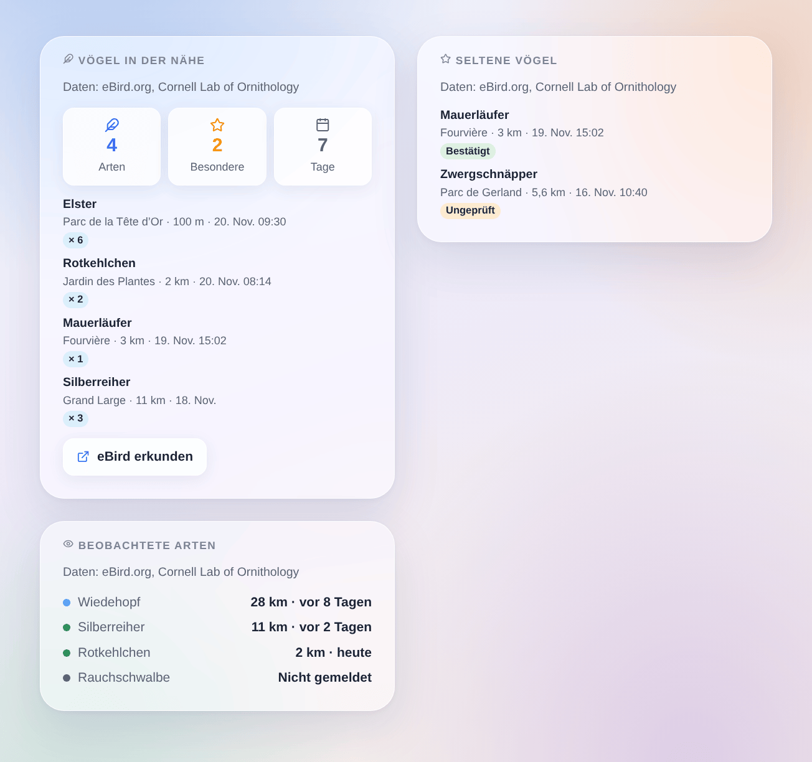

# eBird

## Überblick

Diese Integration bringt **eBird** in Gladys. eBird, betrieben vom Cornell Lab of Ornithology, sammelt die Vogelbeobachtungen von Vogelkundigen auf der ganzen Welt. Die Integration liest, was rund um eines deiner Häuser gemeldet wurde: die in den letzten Tagen gesehenen Arten, die **besonderen** Meldungen (seltene Arten oder Vögel außerhalb der Saison) und die Arten, die du **beobachtest**, etwa die ersten Schwalben im Frühling oder ein Wiedehopf, der in die Gegend zurückkehrt.

Sie bietet Geräte im Erkennungsbildschirm, zwei Szenenauslöser (ein seltener Vogel in der Nähe, eine beobachtete Art in der Nähe), eine Szenenaktion (Wo wurde eine Art zuletzt gesehen?) und drei Dashboard-Widgets. Sie funktioniert überall auf der Welt.

## Voraussetzungen

- Gladys Assistant 5.3.0 oder neuer.
- Ein Haus mit Standort in Gladys (Einstellungen → Häuser): Die Beobachtungen werden um dieses Haus herum gesucht.
- Ein kostenloses eBird-Konto und ein API-Schlüssel.

### Einen API-Schlüssel holen

1. Erstelle ein kostenloses Konto auf [ebird.org](https://ebird.org) (oder melde dich an).
2. Öffne [ebird.org/api/keygen](https://ebird.org/api/keygen), akzeptiere die Nutzungsbedingungen und kopiere den Schlüssel.
3. Der Schlüssel ist persönlich und nur für nicht kommerzielle Nutzung: Teile ihn nie.

## Konfiguration

| Feld                 | Standard                 | Bedeutung                                                                                                                  |
| -------------------- | ------------------------ | -------------------------------------------------------------------------------------------------------------------------- |
| eBird-API-Schlüssel  | —                        | Pflichtfeld. Nie wieder angezeigt, nie protokolliert                                                                       |
| Haus                 | erstes Haus mit Standort | Der Mittelpunkt der Suche                                                                                                  |
| Umkreis (km)         | 10                       | 1 bis 50 km                                                                                                                |
| Tage zurück          | 7                        | 1 bis 30 Tage                                                                                                              |
| Beobachtete Arten    | —                        | Bis zu 10, durch Kommas getrennt: Name (Deutsch, Englisch, Französisch, Spanisch), wissenschaftlicher Name oder eBird-Code |
| Abfrage alle         | 1 Stunde                 | 30 Minuten, 1 Stunde oder 3 Stunden                                                                                        |
| Sprache              | Automatisch              | Gerätenamen und Szenentexte; automatisch folgt der Sprache des zuletzt angezeigten Widgets                                 |
| eBird jetzt abfragen | —                        | Prüft den Schlüssel, liest sofort und fasst jede beobachtete Art zusammen                                                  |

Der eBird-Code einer Art steht in der Adresse ihrer Seite auf ebird.org: `ebird.org/species/eurhoo` ist der Wiedehopf. Der Status des Konfigurationsbildschirms nennt die Arten, die nicht gefunden wurden.

## Verwendung

### Geräte

Im Erkennungsbildschirm:

- **Vögel um \<Haus\>**: gemeldete Arten, besondere Meldungen, die letzte besondere Meldung („Mauerläufer · 3 km · Fourvière“).
- **\<Art\> (eBird)**, eines pro beobachteter Art: in der Nähe gemeldet (im Umkreis, über die gewählten Tage), nächste aktuelle Meldung in km (bis 50 km), Tage seit dieser Meldung.

„Arten“ zählt nur echte Arten: eBird listet auch Gruppen wie „Möwe sp.“ und Hybriden.

### Dashboard-Widgets

- **Vögel in der Nähe**: Anzahl der Arten und besonderen Meldungen, die neuesten Arten mit Ort, Entfernung, Datum und Anzahl.
- **Seltene Vögel**: eine Karte pro besonderer Art, von eBird geprüft oder nicht, mit Links zur Liste und zur Artseite.
- **Beobachtete Arten**: die nächste aktuelle Meldung jeder Art und wann.

Die Namen folgen der Sprache des Dashboards. Die Widgets nennen eBird, wie es dessen Bedingungen verlangen.

### Szenen

- **Auslöser „eBird: seltener Vogel in der Nähe“**: eine neue besondere Meldung im Umkreis, einmal pro Liste und Art (höchstens 10 pro Abfrage). Variablen: Art, wissenschaftlicher Name, Code, Anzahl, Ort, Entfernung, Datum, Uhrzeit, geprüft, Link zur Liste, Zusammenfassung, Haus.
- **Auslöser „eBird: beobachtete Art in der Nähe“**: eine beobachtete Art wird wieder im Umkreis gemeldet; du kannst nach einer Art filtern.
- **Aktion „eBird: Wo wurde eine Art gesehen?“**: die nächste Meldung einer Art im Umkreis von 50 km über bis zu 30 Tage, mit einer fertigen Zusammenfassung für eine Nachricht oder eine Sprachantwort.

Die erste Abfrage nach einer Änderung von Haus, Umkreis, Tagen oder beobachteten Arten ist eine Ausgangsbasis: Was eBird bereits listet, löst nichts aus. Ein Neustart löst nie zweimal aus.

Beispiele: Wenn ein seltener Vogel in der Nähe gemeldet wird, die Zusammenfassung und den Link zur Liste per Telegram senden; wenn die Rauchschwalbe zurück ist, „Die Schwalben sind zurück!“ in der Küche ansagen.

### Transport

Nur Cloud: eBird erhält den auf etwa 1 km gerundeten Standort des Hauses, den Umkreis und die Codes der beobachteten Arten. Der Schlüssel reist im Header, nie in einer Webadresse.

## Fehlerbehebung

- **„eBird hat den API-Schlüssel abgelehnt“**: Kopiere ihn erneut von ebird.org/api/keygen.
- **„Kein Haus in Gladys hat einen Standort“**: Lege den Standort des Hauses unter Einstellungen → Häuser fest.
- **„Nicht in der eBird-Taxonomie gefunden“**: Prüfe die Schreibweise oder gib den wissenschaftlichen Namen oder den eBird-Code ein.
- **Wenige oder keine Meldungen**: Vergrößere den Umkreis oder die Tage; eBird hängt von den Beobachtern deiner Region ab.
- **Eine besondere Meldung „Ungeprüft“**: Ein regionaler Prüfer von eBird hat sie noch nicht angesehen.
- Protokolle: Einstellungen → Supervision, die Protokolle der Integration. Teile nie deinen API-Schlüssel.
