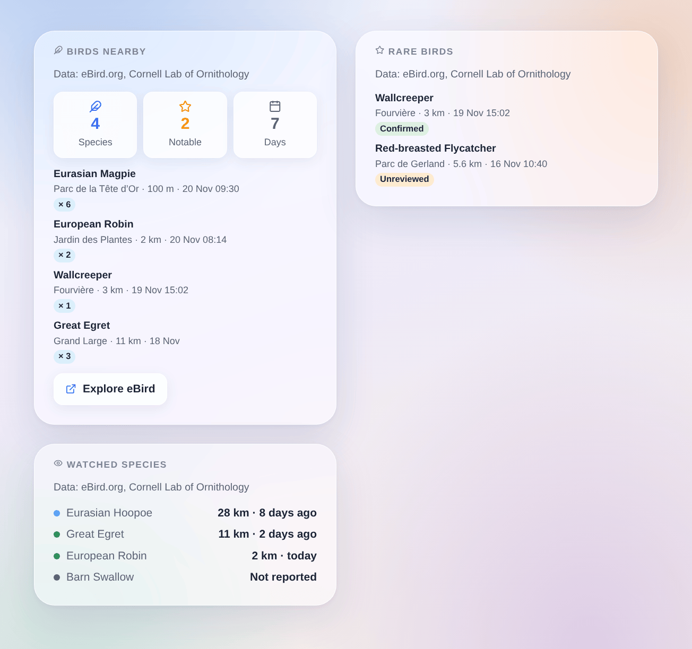

# eBird

## Overview

This integration brings **eBird** into Gladys. eBird, run by the Cornell Lab of Ornithology, gathers the bird observations of birdwatchers around the world. The integration reads what was reported around one of your houses: the species seen lately, the **notable** reports (rare species, or birds out of season) and the species you **watch**, such as the first swallows of spring or a hoopoe back in the area.

It offers devices on the Discovery screen, two scene triggers (a rare bird nearby, a watched species nearby), a scene action (where was a species seen lately?) and three dashboard widgets. It works everywhere in the world.

## Prerequisites

- Gladys Assistant 5.3.0 or later.
- A house with a position in Gladys (Settings → Houses): the observations are searched around it.
- A free eBird account and an API key.

### Get an API key

1. Create a free account on [ebird.org](https://ebird.org) (or sign in).
2. Open [ebird.org/api/keygen](https://ebird.org/api/keygen), accept the terms of use and copy the key.
3. The key is personal and for non-commercial use: never share it.

## Configuration

| Field           | Default                     | Meaning                                                                                                      |
| --------------- | --------------------------- | ------------------------------------------------------------------------------------------------------------ |
| eBird API key   | —                           | Required. Never shown again, never logged                                                                    |
| House           | first house with a position | The center of the search                                                                                     |
| Radius (km)     | 10                          | 1 to 50 km                                                                                                   |
| Days back       | 7                           | 1 to 30 days                                                                                                 |
| Watched species | —                           | Up to 10, separated by commas: common name (English, French, German, Spanish), scientific name or eBird code |
| Reading every   | 1 hour                      | 30 minutes, 1 hour or 3 hours                                                                                |
| Language        | Automatic                   | Device names and scene texts; automatic follows the language of the last widget shown                        |
| Read eBird now  | —                           | Checks the key, reads now and sums up each watched species                                                   |

The eBird code of a species is in the address of its page on ebird.org: `ebird.org/species/eurhoo` is the Eurasian Hoopoe. The status of the configuration screen names the species it could not find.

## Usage

### Devices

On the Discovery screen:

- **Birds around \<house\>**: species reported, notable reports, the last notable report ("Wallcreeper · 3 km · Fourvière").
- **\<species\> (eBird)**, one per watched species: reported nearby (within the radius over the days), nearest recent report in km (up to 50 km), days since that report.

"Species" counts the true species only: eBird also lists groups such as "gull sp." and hybrids.

### Dashboard widgets

- **Birds nearby**: species and notable counts, the most recent species with place, distance, date and how many.
- **Rare birds**: one card per notable species, reviewed by eBird or not, with links to the checklist and the species page.
- **Watched species**: the nearest recent report of each one and when.

The names follow the language of the dashboard. The widgets credit eBird, as its terms ask.

### Scenes

- **Trigger "eBird: rare bird nearby"**: a new notable report within the radius, once per checklist and species (at most 10 per reading). Variables: species, scientific name, code, how many, place, distance, date, time, reviewed, checklist link, summary, house.
- **Trigger "eBird: watched species nearby"**: a watched species is reported within the radius again; you can filter on one species.
- **Action "eBird: where was a species seen?"**: the nearest report of a species within 50 km over up to 30 days, with a ready-made summary for a message or a spoken answer.

The first reading after a change of house, radius, days or watched species is a baseline: what eBird already lists fires nothing. A restart never fires twice.

Examples: when a rare bird is reported nearby, send the summary and the checklist link by Telegram; when the Barn Swallow is back, say "The swallows are back!" in the kitchen.

### Transport

Cloud only: eBird receives the position of the house rounded to about 1 km, the radius and the codes of the watched species. The key travels in a header, never in a web address.

## Troubleshooting

- **"eBird refused the API key"**: copy it again from ebird.org/api/keygen.
- **"No house of Gladys has a position"**: set the position of the house in Settings → Houses.
- **"Not found in the eBird taxonomy"**: check the spelling, or type the scientific name or the eBird code.
- **Few or no reports**: widen the radius or the days; eBird depends on the observers of your area.
- **A notable report "Unreviewed"**: a regional reviewer of eBird has not checked it yet.
- Logs: Settings → Supervision, the logs of the integration. Never share your API key.
