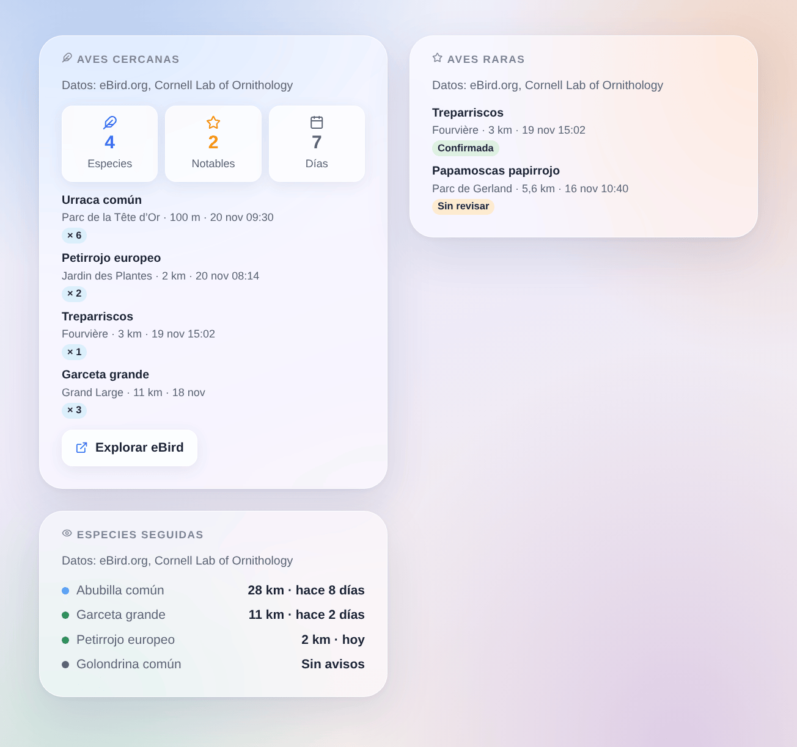

# eBird

## Presentación

Esta integración lleva **eBird** a Gladys. eBird, gestionado por el Cornell Lab of Ornithology, reúne las observaciones de aves de ornitólogos de todo el mundo. La integración lee lo que se ha observado alrededor de una de sus casas: las especies vistas en los últimos días, las observaciones **notables** (especies raras o aves fuera de temporada) y las especies que **sigue**, como las primeras golondrinas de la primavera o una abubilla de vuelta por la zona.

Propone dispositivos en la pantalla de descubrimiento, dos disparadores de escena (un ave rara cerca, una especie seguida cerca), una acción de escena (¿dónde se vio una especie hace poco?) y tres widgets de panel. Funciona en todo el mundo.

## Requisitos

- Gladys Assistant 5.3.0 o posterior.
- Una casa con ubicación en Gladys (Ajustes → Casas): las observaciones se buscan a su alrededor.
- Una cuenta gratuita de eBird y una clave de API.

### Obtener una clave de API

1. Cree una cuenta gratuita en [ebird.org](https://ebird.org) (o inicie sesión).
2. Abra [ebird.org/api/keygen](https://ebird.org/api/keygen), acepte las condiciones de uso y copie la clave.
3. La clave es personal y para uso no comercial: no la comparta nunca.

## Configuración

| Campo                 | Por defecto                | Significado                                                                                                         |
| --------------------- | -------------------------- | ------------------------------------------------------------------------------------------------------------------- |
| Clave de API de eBird | —                          | Obligatoria. Nunca se vuelve a mostrar ni se registra                                                               |
| Casa                  | primera casa con ubicación | El centro de la búsqueda                                                                                            |
| Radio (km)            | 10                         | 1 a 50 km                                                                                                           |
| Días atrás            | 7                          | 1 a 30 días                                                                                                         |
| Especies seguidas     | —                          | Hasta 10, separadas por comas: nombre común (español, inglés, francés, alemán), nombre científico o código de eBird |
| Lectura cada          | 1 hora                     | 30 minutos, 1 hora o 3 horas                                                                                        |
| Idioma                | Automático                 | Nombres de los dispositivos y textos de las escenas; automático sigue el idioma del último widget mostrado          |
| Leer eBird ahora      | —                          | Comprueba la clave, lee ahora y resume cada especie seguida                                                         |

El código de eBird de una especie aparece en la dirección de su página en ebird.org: `ebird.org/species/eurhoo` es la Abubilla común. El estado de la pantalla de configuración nombra las especies que no encontró.

## Uso

### Dispositivos

En la pantalla de descubrimiento:

- **Aves alrededor de \<casa\>**: especies observadas, observaciones notables, la última observación notable («Treparriscos · 3 km · Fourvière»).
- **\<especie\> (eBird)**, uno por especie seguida: observada cerca (en el radio, durante los días elegidos), observación reciente más cercana en km (hasta 50 km), días desde esa observación.

«Especies» solo cuenta las especies verdaderas: eBird también lista grupos como «gaviota sp.» e híbridos.

### Widgets del panel

- **Aves cercanas**: número de especies y de observaciones notables, las especies más recientes con lugar, distancia, fecha y número.
- **Aves raras**: una tarjeta por especie notable, revisada o no por eBird, con enlaces a la lista y a la página de la especie.
- **Especies seguidas**: la observación reciente más cercana de cada una y cuándo.

Los nombres siguen el idioma del panel. Los widgets citan a eBird, como piden sus condiciones.

### Escenas

- **Disparador «eBird: ave rara cerca»**: una nueva observación notable en el radio, una vez por lista y especie (10 como máximo por lectura). Variables: especie, nombre científico, código, número, lugar, distancia, fecha, hora, revisada, enlace de la lista, resumen, casa.
- **Disparador «eBird: especie seguida cerca»**: una especie seguida vuelve a observarse en el radio; puede filtrar por una especie.
- **Acción «eBird: ¿dónde se vio una especie?»**: la observación más cercana de una especie a menos de 50 km en hasta 30 días, con un resumen listo para un mensaje o una respuesta de voz.

La primera lectura tras un cambio de casa, radio, días o especies seguidas sirve de referencia: lo que eBird ya lista no dispara nada. Un reinicio nunca dispara dos veces.

Ejemplos: cuando se observa un ave rara cerca, enviar el resumen y el enlace de la lista por Telegram; cuando vuelve la Golondrina común, anunciar «¡Han vuelto las golondrinas!» en la cocina.

### Transporte

Solo nube: eBird recibe la posición de la casa redondeada a aprox. 1 km, el radio y los códigos de las especies seguidas. La clave viaja en una cabecera, nunca en una dirección web.

## Solución de problemas

- **«eBird ha rechazado la clave de API»**: cópiela de nuevo desde ebird.org/api/keygen.
- **«Ninguna casa de Gladys tiene ubicación»**: indique la ubicación de la casa en Ajustes → Casas.
- **«No encontrado en la taxonomía de eBird»**: compruebe la ortografía o escriba el nombre científico o el código de eBird.
- **Pocas o ninguna observación**: amplíe el radio o los días; eBird depende de los observadores de su zona.
- **Una observación notable «Sin revisar»**: un revisor regional de eBird aún no la ha examinado.
- Registros: Ajustes → Supervisión, los registros de la integración. No comparta nunca su clave de API.
