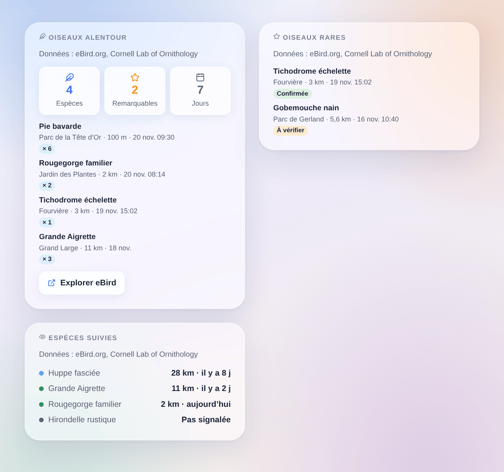

# eBird

## Présentation

Cette intégration amène **eBird** dans Gladys. eBird, porté par le Cornell Lab of Ornithology, rassemble les observations d’oiseaux des ornithologues du monde entier. L’intégration lit ce qui a été signalé autour d’une de vos maisons : les espèces vues ces derniers jours, les observations **remarquables** (espèces rares, ou oiseaux hors saison) et les espèces que vous **suivez**, comme les premières hirondelles du printemps ou une huppe de retour dans le coin.

Elle propose des appareils dans l’écran de découverte, deux déclencheurs de scène (un oiseau rare à proximité, une espèce suivie à proximité), une action de scène (où a-t-on vu une espèce récemment ?) et trois widgets de tableau de bord. Elle fonctionne partout dans le monde.

## Prérequis

- Gladys Assistant 5.3.0 ou plus récent.
- Une maison avec une position dans Gladys (Paramètres → Maisons) : les observations sont cherchées autour d’elle.
- Un compte eBird gratuit et une clé d’API.

### Obtenir une clé d’API

1. Créez un compte gratuit sur [ebird.org](https://ebird.org) (ou connectez-vous).
2. Ouvrez [ebird.org/api/keygen](https://ebird.org/api/keygen), acceptez les conditions d’utilisation et copiez la clé.
3. La clé est personnelle et réservée à un usage non commercial : ne la partagez jamais.

## Configuration

| Champ                 | Défaut                             | Rôle                                                                                                                       |
| --------------------- | ---------------------------------- | -------------------------------------------------------------------------------------------------------------------------- |
| Clé d’API eBird       | —                                  | Obligatoire. Plus jamais affichée, jamais journalisée                                                                      |
| Maison                | première maison qui a une position | Le centre de la recherche                                                                                                  |
| Rayon (km)            | 10                                 | 1 à 50 km                                                                                                                  |
| Jours en arrière      | 7                                  | 1 à 30 jours                                                                                                               |
| Espèces suivies       | —                                  | 10 au plus, séparées par des virgules : nom commun (français, anglais, allemand, espagnol), nom scientifique ou code eBird |
| Lecture toutes les    | 1 heure                            | 30 minutes, 1 heure ou 3 heures                                                                                            |
| Langue                | Automatique                        | Noms des appareils et textes des scènes ; automatique suit la langue du dernier widget affiché                             |
| Lire eBird maintenant | —                                  | Vérifie la clé, lit tout de suite et résume chaque espèce suivie                                                           |

Le code eBird d’une espèce figure dans l’adresse de sa page sur ebird.org : `ebird.org/species/eurhoo` est la Huppe fasciée. Le statut de l’écran de configuration nomme les espèces introuvables.

## Utilisation

### Appareils

Dans l’écran de découverte :

- **Oiseaux autour de \<maison\>** : espèces signalées, observations remarquables, dernière observation remarquable (« Tichodrome échelette · 3 km · Fourvière »).
- **\<espèce\> (eBird)**, un par espèce suivie : signalée à proximité (dans le rayon, sur les jours choisis), observation récente la plus proche en km (jusqu’à 50 km), jours depuis cette observation.

« Espèces » ne compte que les vraies espèces : eBird liste aussi des groupes comme « goéland sp. » et des hybrides.

### Widgets du tableau de bord

- **Oiseaux alentour** : nombres d’espèces et d’observations remarquables, espèces les plus récentes avec lieu, distance, date et nombre d’individus.
- **Oiseaux rares** : une carte par espèce remarquable, vérifiée par eBird ou non, avec des liens vers la liste et la page de l’espèce.
- **Espèces suivies** : l’observation récente la plus proche de chacune et sa date.

Les noms suivent la langue du tableau de bord. Les widgets citent eBird, comme ses conditions le demandent.

### Scènes

- **Déclencheur « eBird : oiseau rare à proximité »** : une nouvelle observation remarquable dans le rayon, une fois par liste et par espèce (10 au plus par lecture). Variables : espèce, nom scientifique, code, nombre, lieu, distance, date, heure, vérifiée, lien de la liste, résumé, maison.
- **Déclencheur « eBird : espèce suivie à proximité »** : une espèce suivie est de nouveau signalée dans le rayon ; vous pouvez filtrer sur une espèce.
- **Action « eBird : où a-t-on vu une espèce ? »** : l’observation la plus proche d’une espèce à moins de 50 km sur 30 jours au plus, avec un résumé prêt pour un message ou une réponse vocale.

La première lecture après un changement de maison, de rayon, de jours ou d’espèces suivies sert de référence : ce qu’eBird liste déjà ne déclenche rien. Un redémarrage ne déclenche jamais deux fois.

Exemples : quand un oiseau rare est signalé à proximité, envoyer le résumé et le lien de la liste par Telegram ; quand l’Hirondelle rustique est de retour, annoncer « Les hirondelles sont de retour ! » dans la cuisine.

### Transport

Cloud uniquement : eBird reçoit la position de la maison arrondie à environ 1 km, le rayon et les codes des espèces suivies. La clé voyage dans un en-tête, jamais dans une adresse web.

## Dépannage

- **« eBird a refusé la clé d’API »** : recopiez-la depuis ebird.org/api/keygen.
- **« Aucune maison de Gladys n’a de position »** : renseignez la position de la maison dans Paramètres → Maisons.
- **« Introuvable dans la taxonomie eBird »** : vérifiez l’orthographe, ou tapez le nom scientifique ou le code eBird.
- **Peu ou pas d’observations** : élargissez le rayon ou les jours ; eBird dépend des observateurs de votre région.
- **Une observation remarquable « À vérifier »** : un vérificateur régional d’eBird ne l’a pas encore examinée.
- Journaux : Paramètres → Supervision, les journaux de l’intégration. Ne partagez jamais votre clé d’API.
